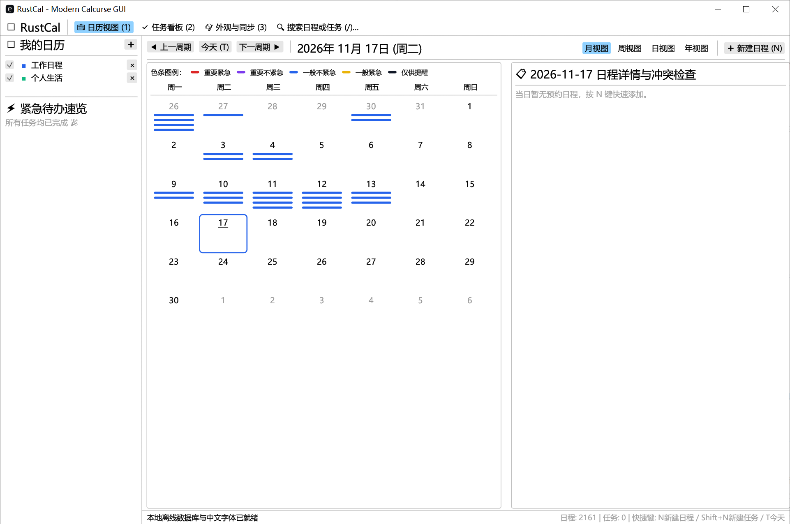
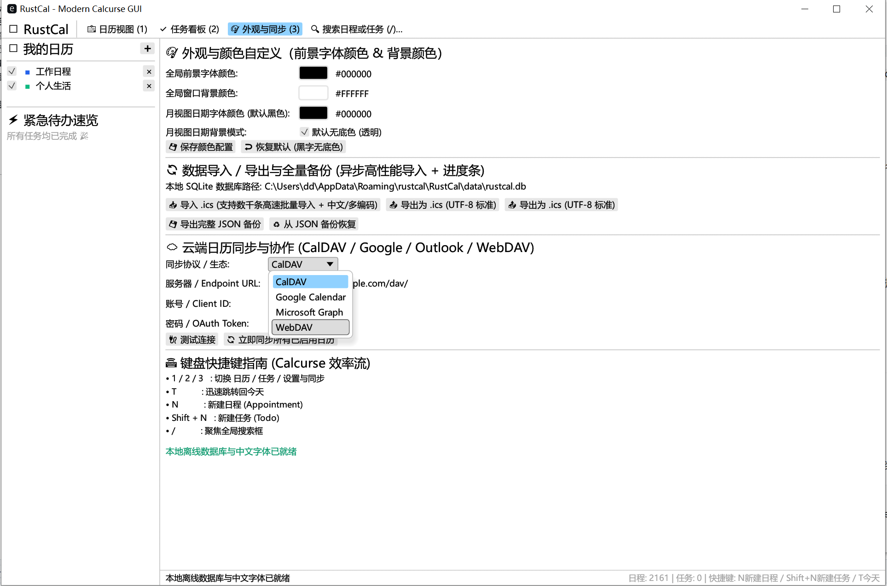

# RustCal v0.3 [👉English Version](#english)

基于 **Rust + egui + SQLite** 开发的跨平台现代 GUI 日历与任务管理软件，完整复刻 `calcurse` 核心能力并扩展现代日历生态。感谢 Calcurse 启发，一直在Termux 和 Linux下使用 calcurse 管理日程
支持统信Linux，具体见release的uoslinux包

## 软件界面


可以自定义颜色



## v0.3 核心修复与升级
1. **异步后台导入 + 实时进度条 + SQLite 事务批量写入（彻底解决大文件假死）**：
   - 导入包含数千条日程的 `.ics` / `.json` 文件时，置于后台独立线程执行解码、解析与 SQLite 单事务（`Transaction` + 预编译 `Statement`）批量入库，数千条日程入库耗时从数秒降至几十毫秒。
   - UI 界面弹出实时进度条模态窗（展示当前阶段、百分比及已处理/总条数），并通过 `ctx.request_repaint()` 保持界面流畅响应，绝不假死。
2. **彻底修复中文乱码问题（双层防护：解码 + CJK 字体渲染）**：
   - **解码层修复**：修复此前无 BOM `UTF-16LE` 启发式误判逻辑（英文 ICS 关键词含 ASCII 偶数字节特征可能干扰判定），改用精确验证解码结果中是否包含 `BEGIN:VCALENDAR` / `VEVENT` 结构标记来校验 UTF-16LE/BE、UTF-8、GB18030/GBK、Big5、Shift_JIS 等编码；同时正确处理 RFC 5545 多字节 UTF-8/GBK 折行（先按原始字节展开折行，再整体解码，避免多字节汉字在 75 字节处被折行截断导致乱码！）。
   - **渲染层修复**：扩展跨平台 CJK 字体探测路径（覆盖 Windows 10/11 微软雅黑/黑体/宋体/楷体、macOS 苹方/华文黑体、Linux NotoSansCJK/WenQuanYi），并同时注册到 `Proportional` 与 `Monospace` 字体族首位，启动时校验字体加载状态。

## 特色优势
- 单文件运行在多个平台，多个架构
- 日历搜索时可以切换到年视图，会自动显示全年包含`搜索关键字`的日程数量，并在右边即时显示相关日程，特别方便年终总结回顾
- 同步时出错会有详细出错信息，便于用户排查原因

## 功能

- 导入导出标准日历格式 .ics 文件
- 解析多语言（英语、中文、日语等）
- 搜索所有日程（月视图、周视图、日视图、年视图）
- 日程安排（红色为重要紧急，紫色为重要不紧急，蓝色为一般不紧急，橙色为一般紧急，黑色为事项提醒
- 待办任务（9个优先级别）
- 支持工作、生活和自定义等多个日历
- 支持全键盘快捷键操作
- 支持导入、导出与全量备份至本地sqlite数据库，支持JSON 格式备份与恢复
- 支持云端同步，支持 CalDAV、WebDAV 协议
- 所有处理在本机完成
  
## 编译运行
```bash
cargo build --release
cargo run --release
```
## 跨平台编译

建议在对应操作系统的原生 runner 上编译，避免 Apple SDK、Windows linker 和 Linux 系统库差异。源码不需要修改。

```
# Windows x64（在 Windows 上运行）
rustup target add x86_64-pc-windows-msvc
cargo build --release --target x86_64-pc-windows-msvc

# macOS Apple Silicon（在 macOS 上运行）
rustup target add aarch64-apple-darwin
cargo build --release --target aarch64-apple-darwin

# macOS Intel（在 macOS 上运行）
rustup target add x86_64-apple-darwin
cargo build --release --target x86_64-apple-darwin

# Linux x64（在 Linux 上运行）
rustup target add x86_64-unknown-linux-gnu
cargo build --release --target x86_64-unknown-linux-gnu

# Linux ARM64（在配置好 ARM64 linker/sysroot 的 Linux 环境中运行）
rustup target add aarch64-unknown-linux-gnu
cargo build --release --target aarch64-unknown-linux-gnu
```

<a id="english"></a>
### RustCal v0.3

A cross-platform, modern GUI calendar and task management software developed using **Rust + egui + SQLite**. It fully replicates the core capabilities of `calcurse` while expanding into a modern calendar ecosystem. Special thanks to Calcurse for the inspiration; I've been using calcurse under Termux and Linux to manage my schedule for a long time.

- Supports **Tongxin Linux (UOS)**—see the `uoslinux` package in the releases.
- **Software Interface:** Supports customizable colors.

### v0.3 Core Fixes & Upgrades

1. **Asynchronous Background Import + Real-Time Progress Bar + SQLite Transaction Batch Writing (Completely resolved UI freezing on large files):**
   - When importing `.ics` / `.json` files containing thousands of schedule entries, the decoding, parsing, and batch insertion into SQLite are executed in an independent background thread using a single transaction (`Transaction` + prepared statements). This reduces the import time for thousands of entries from several seconds down to tens of milliseconds.
   - A real-time progress bar modal pops up on the UI (showing the current stage, percentage, and processed vs. total item count), keeping the interface smooth and responsive via `ctx.request_repaint()`—preventing any UI freezing.
2. **Completely Fixed Chinese Character Garbled Text / Mojibake (Double-layer protection: Decoding + CJK font rendering):**
   - **Decoding Layer Fixes:** Fixed a previous heuristic misjudgment bug with BOM-less UTF-16LE encoding (where ASCII even-numbered bytes in English ICS keywords could interfere with detection). It now uses accurate verification of `BEGIN:VCALENDAR` or `VEVENT` structure markers to validate UTF-16LE/BE, UTF-8, GB18030/GBK, Big5, Shift_JIS, and other encodings. Additionally, it correctly handles RFC 5545 multi-byte UTF-8/GBK line folding (unfolding lines by original raw bytes first, then decoding as a whole, preventing multi-byte Chinese characters from being truncated at the 75-byte mark and causing garbled text).
   - **Rendering Layer Fixes:** Expanded cross-platform CJK font discovery paths (covering Windows 10/11 Microsoft YaHei, SimHei, SimSun, KaiTi; macOS PingFang SC, STHeiti; Linux NotoSansCJK, WenQuanYi). Fonts are registered at the very top of both Proportional and Monospace font families, with font loading status validated at startup.

### Key Features & Advantages

- **Single binary execution** across multiple platforms and architectures.
- **Year View Search Integration:** When searching for calendar events, you can switch to the year view. It automatically displays the count of matching events for each month across the entire year and instantly lists the relevant events on the right side—making year-end reviews exceptionally convenient.
- **Detailed Sync Error Reporting:** Sync errors include detailed messages to help users easily troubleshoot and identify causes.

### Features

- Import and export standard calendar **`.ics`** files.
- Support for parsing multi-language content (English, Chinese, Japanese, etc.).
- Universal schedule search across **Month, Week, Day, and Year views**.
- **Event Scheduling & Priority Color Coding:**
  - 🔴 Red: Important & Urgent
  - 🟣 Purple: Important & Not Urgent
  - 🔵 Blue: General & Not Urgent
  - 🟠 Orange: General & Urgent
  - ⚫ Black: Reminders / Notes
- **To-Do Tasks:** Supports 9 priority levels.
- **Multiple Calendars:** Supports separating Work, Personal, and custom user calendars.
- **Full Keyboard Shortcut Navigation.**
- **Backup & Recovery:** Supports importing, exporting, and full backups to a local SQLite database, as well as JSON format backup and restoration.
- **Cloud Synchronization:** Supports **CalDAV** and **WebDAV** protocols.
- **Local-First Privacy:** All data processing is done entirely on your local machine.

跨操作系统交叉编译还需要目标平台 linker / SDK；优先使用 GitHub Actions 对应平台 runner。
